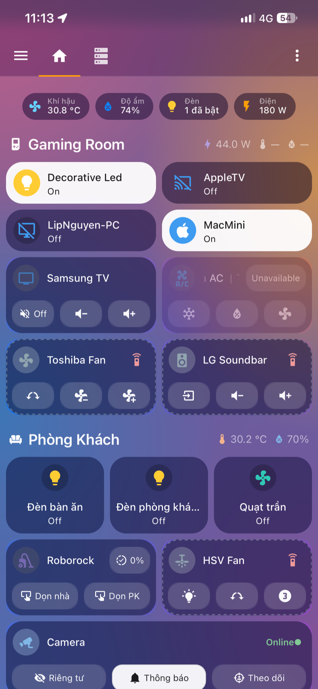
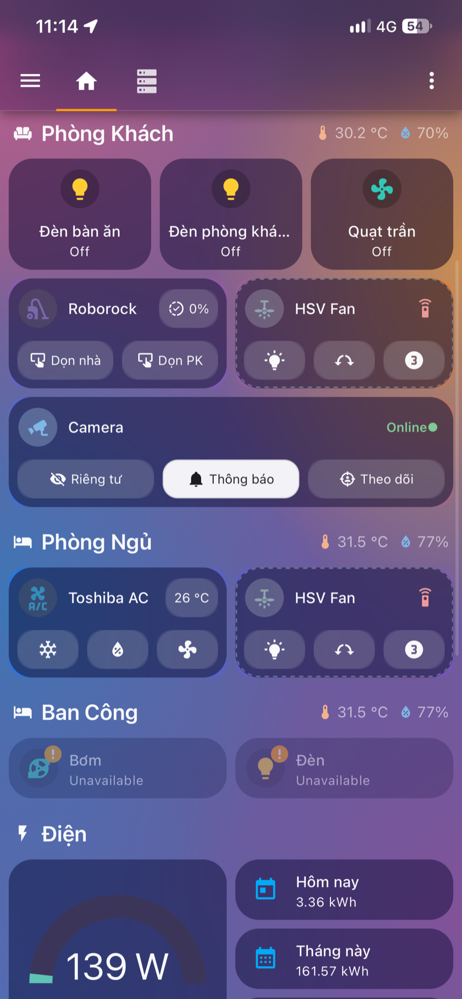
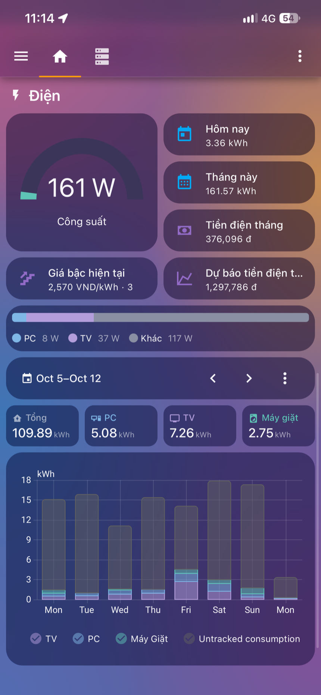
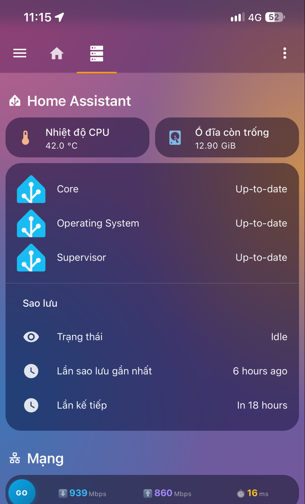
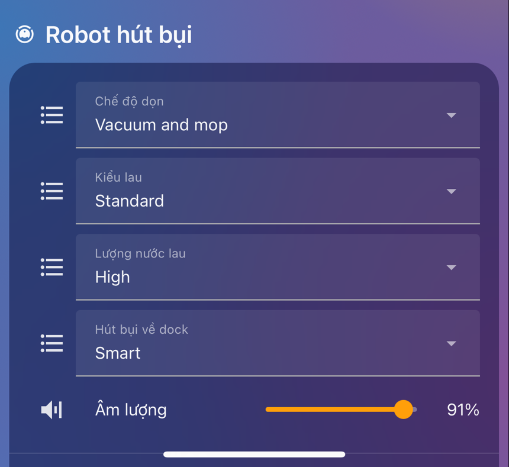

# Aurora Home theme cho Home Assistant

Theme kính mờ cho Home Assistant: nền gradient hồng, cam, xanh, tím; card tối trong mờ bo tròn; chữ trắng; màu trạng thái tươi, rõ. Thiết bị đang bật nổi lên bằng nền trắng, nhìn một lần là biết cái nào bật, cái nào tắt.

Theme chỉ đổi màu sắc và kiểu dáng. Nó không đổi bố cục dashboard, không phụ thuộc entity nào và không tải ảnh từ bên ngoài.

Yêu cầu Home Assistant 2026.8 trở lên.

## Ảnh chụp

Ảnh chụp bản **Aurora Home Plus** trên điện thoại.

| Tổng quan | Các phòng | Điện năng |
|:---:|:---:|:---:|
|  |  |  |
| Ô đang bật nền trắng, ô đang tắt nền tối với icon màu | Tile, Bubble Card và các nút nhỏ đang bật | Tile số liệu, gauge và biểu đồ giữ nền tối |

| Trang hệ thống | Ô chọn và thanh trượt |
|:---:|:---:|
|  |  |
| Card danh sách entity | Ô chọn và thanh trượt |

Bố cục trong ảnh là của một dashboard riêng. Theme chỉ đổi màu sắc và kiểu dáng, không tạo ra bố cục này.

## Hai bản trong cùng một file

File `aurora-home.yaml` chứa hai theme chính: **Aurora Home** và **Aurora Home Plus**. Bản Plus có thêm bốn bản [hình nền khác](#các-bản-hình-nền). Cài một lần là có tất cả, chọn bản nào thì chọn trong Hồ sơ.

### Giống nhau

Hai bản dùng chung toàn bộ phần sau:

- hình nền gradient, độ trong và độ bo của card;
- màu chữ, font, màu chủ đạo;
- thanh trên, thanh bên, hộp thoại, pop-up;
- màu trạng thái;
- biến cho Bubble Card và Mushroom.

### Khác nhau

Khác biệt duy nhất là cách hiển thị thiết bị đang **bật** và đang **tắt**:

| | Aurora Home | Aurora Home Plus |
|---|---|---|
| Cần card-mod | Không | **Có** |
| Tile của thiết bị đang bật | Nền tối như lúc tắt, chỉ icon đổi màu | Nền trắng, chữ đen, icon trắng trên vòng tròn màu |
| Tile của thiết bị đang tắt | Icon xám | Icon giữ màu thiết bị trên vòng tròn tối |
| Sub-button đang bật của Bubble Card | Nền cam, chữ trắng | Viên trắng, chữ đen |
| Card lớn của Bubble Card khi bật | Không đổi | Nền trắng, chữ đen, **nếu dashboard dùng biến của theme** (xem [bên dưới](#card-lớn-của-bubble-card)) |
| Tile sensor | Nền tối | Nền tối |

### Các bản hình nền

Bản Plus có thêm bốn bản hình nền khác. Tất cả đều là gradient CSS tự vẽ, không dùng ảnh, và **đều cần card-mod** như bản Plus.

| Hình nền | Tông màu | Tên theme |
|---|---|---|
| Mặc định | hồng, cam, xanh, tím | `Aurora Home` (không cần card-mod), `Aurora Home Plus` |
| Ocean | xanh ngọc, xanh da trời, chàm | `Aurora Home Plus Ocean` |
| Sunset | hồng đậm, cam, san hô, tím | `Aurora Home Plus Sunset` |
| Forest | xanh lá, vàng ô liu, xanh cổ vịt | `Aurora Home Plus Forest` |
| Midnight | chàm, tím, xanh than | `Aurora Home Plus Midnight` |

Các bản này chỉ khác hình nền và màu nền của trang cài đặt, thanh bên, menu. Mọi thứ khác giống `Aurora Home Plus`. Ảnh chụp ở trên là bản mặc định.

Chỉ có `Aurora Home` là dùng được khi chưa cài card-mod.

### Vì sao tách làm hai

Một theme thuần của Home Assistant chỉ đổi được màu chung. Nó không biết thiết bị nào đang bật, nên không thể đổi nền của riêng ô đang bật. Bản Plus dùng card-mod để chèn CSS theo trạng thái của từng ô.

### Nên chọn bản nào

- **Chưa cài card-mod, hoặc không muốn cài thêm gì:** chọn **Aurora Home**.
- **Muốn thiết bị đang bật nổi hẳn lên bằng nền trắng:** cài card-mod rồi chọn **Aurora Home Plus**.
- **Dashboard đã tự tô màu card khi bật bằng `card_mod` riêng:** bản Plus sẽ ghi đè màu đó trên các tile (đổi thành nền trắng). Nếu muốn giữ màu riêng, chọn **Aurora Home**.

Nếu chọn bản Plus mà chưa cài card-mod, theme vẫn chạy và không báo lỗi, nhưng sẽ trông giống hệt bản thường. Thấy ô đang bật không đổi sang nền trắng thì kiểm tra lại bước [thêm card-mod](#thêm-card-mod-cho-bản-plus).

## Cài đặt

1. Mở `configuration.yaml`, bảo đảm có hai dòng sau. Nếu vừa thêm thì restart Home Assistant một lần.

   ```yaml
   frontend:
     themes: !include_dir_merge_named themes
   ```

2. Tạo thư mục `themes` trong thư mục cấu hình của HA nếu chưa có (cùng chỗ với `configuration.yaml`).
3. Tải file [themes/aurora-home.yaml](themes/aurora-home.yaml) về và copy vào thư mục `themes` đó.
4. Vào **Developer Tools → Actions**, chạy action `frontend.reload_themes`.
5. Bấm vào tên người dùng ở góc dưới thanh bên để mở **Hồ sơ**, tại mục **Theme** chọn **Aurora Home** hoặc **Aurora Home Plus**.

Theme được chọn theo từng người dùng và từng trình duyệt. Muốn quay lại, chọn theme khác ở cùng chỗ.

### Cài qua HACS (tùy chọn)

Nếu đã có HACS, có thể để HACS tải và cập nhật file thay cho bước 2 và 3:

1. Mở **HACS**, bấm menu ba chấm ở góc trên, chọn **Custom repositories**.
2. Dán địa chỉ repo này, chọn loại **Theme**, bấm **Add**.
3. Tìm **Aurora Home Theme** trong HACS và bấm **Download**.
4. Làm tiếp bước 4 và 5 ở trên.

### Thêm card-mod cho bản Plus

1. Cài [card-mod](https://github.com/thomasloven/lovelace-card-mod) qua HACS.
2. Thêm card-mod vào `extra_module_url` để nó được nạp trước dashboard, rồi restart HA:

   ```yaml
   frontend:
     themes: !include_dir_merge_named themes
     extra_module_url:
       - /hacsfiles/lovelace-card-mod/card-mod.js
   ```

## Chi tiết bản Plus

- **Tile của thiết bị bật/tắt được** (đèn, công tắc, quạt, điều hòa, media player, robot hút bụi, khóa…):
  - Khi bật: nền trắng, chữ đen, icon trắng trên vòng tròn màu đặc.
  - Khi tắt: nền tối, icon giữ màu thiết bị trên vòng tròn tối.
- **Tile sensor** giữ nền tối và icon mặc định.
- **Sub-button đang bật của Bubble Card** thành viên trắng, chữ đen.

Màu icon lấy theo loại thiết bị:

| Loại | Màu |
|---|---|
| Đèn, công tắc, input_boolean | vàng `#FFCC33` |
| Quạt, điều hòa, rèm, máy tạo ẩm | xanh da trời `#35B8E8` |
| Media player | xanh dương `#3E9BF0` |
| Robot hút bụi | cam `#FF9F6B` |
| Khóa | xanh lá `#30D158` |
| Còi | đỏ `#FF453A` |

Quy tắc của tile dùng `!important`, nên ghi đè cả tile đã tự tô nền bằng `card_mod` riêng.

### Đặt màu riêng cho một tile

Thêm biến `--device-color` lên `ha-card` của tile đó bằng `card_mod`:

```yaml
type: tile
entity: switch.may_tinh
card_mod:
  prepend: true
  style: |
    ha-card { --device-color: #3E9BF0; }
```

### Card lớn của Bubble Card

Theme không biết một Bubble Card đang bật hay tắt. Muốn card lớn cũng đổi nền trắng khi bật, dashboard phải tự tô màu trong `styles` của card và dùng các biến sau của theme, kèm màu dự phòng cho theme khác:

| Biến | Dùng cho |
|---|---|
| `--card-on-background-color` | nền card khi bật |
| `--card-on-border-color` | viền card khi bật |
| `--card-on-text-color` | chữ và icon trên card đang bật |
| `--card-on-sub-button-background-color` | nền sub-button trên card đang bật |
| `--card-on-icon-color` | màu icon chính trên card đang bật |
| `--card-on-icon-background-mix` | độ đậm vòng tròn icon, dùng trong `color-mix()` (theme đặt `100%`) |
| `--card-off-icon-mix` | tỉ lệ màu thiết bị của icon khi tắt, dùng trong `color-mix()` (theme đặt `100%`) |
| `--card-off-icon-background-color` | vòng tròn icon khi tắt |

Ví dụ:

```css
${state === 'on' ? '.bubble-container { background-color: var(--card-on-background-color, rgba(127,183,230,0.20)) !important; } .bubble-name, .bubble-state { color: var(--card-on-text-color, var(--primary-text-color)) !important; }' : ''}
```

## Tùy chỉnh

Sửa trực tiếp trong `aurora-home.yaml`, rồi chạy lại `frontend.reload_themes`.

| Muốn đổi | Biến |
|---|---|
| Hình nền | `aurora-home-wallpaper`. Mỗi dòng `radial-gradient` là một vùng màu. |
| Thêm một bản hình nền của riêng bạn | Chép một khối ở cuối file (ví dụ `Aurora Home Plus Ocean`), đổi tên và đổi màu. |
| Độ đậm của card | `aurora-home-surface`. Số cuối là độ đặc, mặc định `0.62`. |
| Độ trong của pop-up Bubble Card | `aurora-home-popup` |
| Màu khi bật của từng loại thiết bị | các biến `state-*-color` |
| Khoảng cách giữa các section | `ha-view-sections-row-gap` |

## Lưu ý

- Hình nền đứng yên theo màn hình, không cuộn theo trang.
- Theme dùng chung một kiểu cho cả chế độ sáng và tối.
- Bản Plus dùng `:has()` và `color-mix()` của CSS, cần trình duyệt từ năm 2023 trở lại đây.

## Giấy phép

Phát hành theo giấy phép [MIT](LICENSE). Bạn được tự do dùng, sửa và chia sẻ lại.
